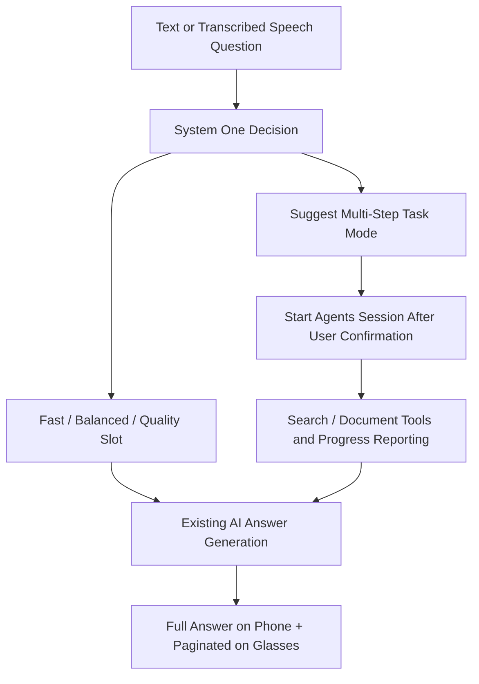

# System One and Agents API Integration Evaluation

> 📖 [繁體中文版](zh-TW/SYSTEM_ONE_AGENTS_RESEARCH.md)

Research date: 2026-10-01 (Asia/Taipei). This document preserves the initial research notes; Gemini / OpenAI decision routing was subsequently added within the user-approved scope and verified on-device—see [Device Smoke Test](DEVICE_SMOKE_TEST.md) for the results. Agents have not been implemented.

> **Experimental:** TypeSafe `Jev`, self-hosted `Laya`, and the multi-step `Agents` architecture design in this document are marked as **Experimental**. They receive no further feature work unless local routing metrics (`routing_metrics`) justify it (see [`CONTRIBUTING.md`](../CONTRIBUTING.md) and [ADR 0004](adr/0004-decision-routing-before-generation.md)).

## Latest User Conditions

- After the user replaced the Gemini API key on the phone, Gemini chat, decision routing, and photo analysis succeeded; OpenAI chat and decision routing also passed on-device API tests. Because the old key was never extracted, we do not speculate on the exact cause of the old key's failure.
- No Laya server URL has been prepared; the existing settings entry is retained, and Laya is not currently counted among the live-testable backends.
- The user approved office photo capture; SPP photo transfer and Gemini analysis succeeded in this run.
- No specific preference was set for the phone preview; we recommend rendering the preview according to the actual screen dimensions reported by the glasses and the glasses layout rules.

## Investigation Findings

| Option | Capabilities and App Usage |
| --- | --- |
| TypeSafe Jev | Structured decisions: choices, scores, and probabilities. Suitable for selecting Fast / Balanced / Quality model tiers while delegating answer generation to existing AI services. Requires TypeSafe credentials. [API Docs](https://docs.typesafe.ai/api) |
| Laya | Can self-host a Jev-compatible HTTP service; the Node version is an ONNX library and cannot be used directly as an Android dependency. [Node Project](https://github.com/receptron/laya), [Model and HTTP Server](https://huggingface.co/convaiinnovations/laya) |
| LLM System One Adapter | TypeSafe's official open-source interface for making identically shaped decisions using LLMs such as OpenAI / Gemini. The Python implementation serves as a reference for evaluation; Android requires implementing the corresponding interface or hosting a service. Self-reported LLM probabilities must not be treated as calibrated Jev probabilities. [Official Adapter](https://github.com/typesafe-ai/system-one-adapter-python) |
| OpenAI Agents API | Managed persistent sessions, tool orchestration, context compaction, and recovery; suited for tasks requiring web search, files, or multiple steps. Pricing covers models, tools, and managed containers used. [Official Overview](https://developers.openai.com/api/docs/guides/agents-api/overview) |

The Laya authors explicitly note that the base model has limited zero-shot performance on some decision benchmarks and should be fine-tuned and calibrated on domain data; Traditional Chinese requires the multilingual model. Published speeds on GPU / Apple CPU cannot be treated as measured latency on this phone or over Taiwan networks. [Honest Limits](https://huggingface.co/convaiinnovations/laya#honest-limits)

Validly formatted System One output does not guarantee that difficulty classification is accurate. Confidence thresholds must be validated against real data and error costs. [TypeSafe Confidence Guide](https://docs.typesafe.ai/confidence)

## Proposed Agents Architecture (Experimental)

> **Experimental:** The multi-step Agents workflow below is a design evaluation only and is not under active development until routing metrics justify prototyping.

This diagram is a design proposal, not a flow currently implemented in the code. The existing `DecisionRouter` only classifies difficulty, selects a slot, and handles fallback; there is no Agents session.

- General Q&A continues to use the existing slots; high difficulty does not necessarily require Agents—for example, mathematical reasoning may only need the Quality model.
- Future iterations should separate "answer difficulty" from "whether search / multi-step tools are needed," offering a bounded set of choices.
- A first phase of Agents could connect only web search and user-supplied documents; camera capture, audio recording, and external writes must remain gated behind explicit user confirmation.
- The proposal recommends having an application backend manage Agents sessions and tool callbacks while the app displays progress, cancel, resume, and final results; the Agents API itself does not automatically connect to phone or glasses hardware.
- Quality, latency, and confidence for Jev, Laya, and the LLM Adapter must be evaluated separately without sharing unverified calibration assumptions.

## Fix and Verification Order

1. **Investigate 401:** Inspect the provider settings actually read on the phone, service updates after settings changes, request endpoints / authentication headers, selected slots, and fallback order. Log only provider, model, HTTP status, and identifiable error category—never log API keys. Verify the app path using the same known-good settings.
2. **Fix preview:** Report screen dimensions when the glasses connect; use the same aspect ratio, typeface, font scale, and status / main text / hint region allocation on the phone. When disconnected, use the most recent dimensions or clearly label the illustrative aspect ratio. Verify that large font sizes and small viewports do not overlap.
3. **Investigate camera connection:** Clarify the respective states, device identification, and retry causes for SPP and CXR BLE; compare against the existing working photo flow and test in the approved office environment. Do not treat SPP connection success as proof of camera availability.
4. **Verify decision routing:** Build Traditional Chinese and English test cases for project scenarios, measuring difficulty classification, misclassification into the Fast model, latency, and fallback; also verify cross-model conversational context.
5. **Agents prototype:** Add a narrowly scoped flow only after a concrete use case is chosen; verify session lifecycle, progress, cancellation, and results before expanding tools.

## User-Confirmed Initial Scope

- Add existing Gemini / OpenAI backends to initial decision routing using the provider API keys already stored on the phone; keep Jev / Laya selectable.
- Defer Agents until app fixes and on-device verification are complete. A specific first use case for Agents has not yet been designated.
- Both phone and glasses are connected via ADB; the user approved photo testing in the office environment.

This research note itself does not establish the root cause of the earlier 401 or CXR BLE issues, nor does it verify that the account can create an Agents session. On-device results are recorded separately in DEVICE_SMOKE_TEST.md.
